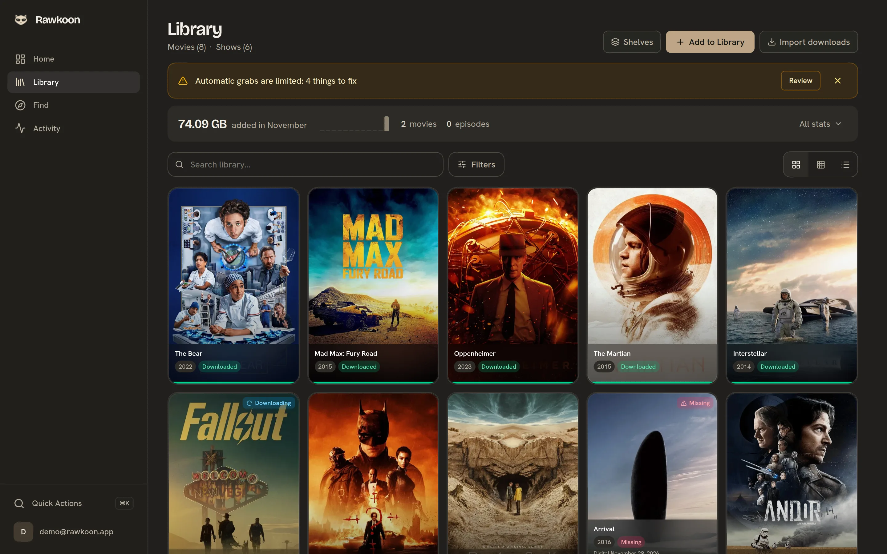
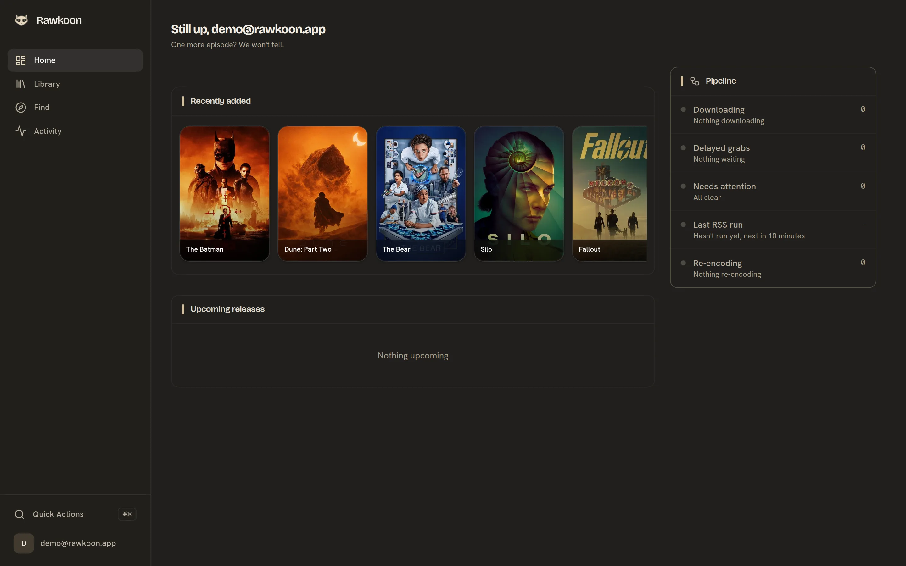

  

<h1 align="center">Rawkoon</h1>

  
  
  
  
  
  

Rawkoon is a self-hosted movie, TV, ebook, and audiobook library with a
built-in download manager. It discovers titles through TMDB and book
providers, searches releases through your indexer, downloads through
qBittorrent, Transmission, or Deluge, and tracks the library from one web UI.
A native iOS app ([public TestFlight beta](https://testflight.apple.com/join/wm3Psb2n))
manages the queue and plays audiobooks offline.

> **Early-stage project.** Breaking changes may occur between releases.

📖 **Documentation: [samlo.cloud/rawkoon](https://samlo.cloud/rawkoon)** ·
📝 **Changelog: [GitHub Releases](https://github.com/samuelloranger/rawkoon/releases)**

## What it does

- **One library for movies, TV and books.** Monitor titles, grab releases
  against [quality profiles](https://samlo.cloud/rawkoon/library/quality-profiles),
  import the files, and follow upcoming releases on a calendar, all in one
  container instead of a stack of separate tools.
- **Requests for the household.** Members ask for a movie, show, or book;
  administrators approve or deny it, on the web or the iPhone
  ([Requests](https://samlo.cloud/rawkoon/library/requests)).
- **Ebooks and audiobooks.** Ebook and audiobook editions share the same
  request and download flow. Listen or read in the browser, and pick up an
  audiobook in its ebook at the same sentence
  ([Books](https://samlo.cloud/rawkoon/library/books)).
- **Shelves.** Curate ordered lists of movies and shows, start one from a
  recipe (Pixar, Studio Ghibli, the Marvel films in story order), and browse
  them on the TV ([Shelves](https://samlo.cloud/rawkoon/library/shelves)).
- **AI release picks (optional).** A language model chooses between the
  releases a profile already accepts; without one, the classic scorer decides
  ([AI release picks](https://samlo.cloud/rawkoon/library/ai-release-picks)).
- **MCP server.** Search the library, check downloads, and request titles from
  Claude, Codex, or other MCP clients ([MCP](https://samlo.cloud/rawkoon/mcp)).

### On every screen

- **Web**: the full product, from setup to library management.
- **iPhone and Mac**: manage the queue and requests, and play audiobooks with
  offline chapters and lock-screen controls
  ([TestFlight](https://testflight.apple.com/join/wm3Psb2n)).
- **Android TV and Fire TV**: [RawkoonTV](https://samlo.cloud/rawkoon/tv-app)
  signs in with a code and plays through Jellyfin.

### Integrations

TMDB, Google Books, Audnexus, Open Library, Prowlarr or Jackett,
qBittorrent, Transmission or Deluge, Jellyfin, and OIDC sign-in. See
[Integrations](https://samlo.cloud/rawkoon/integrations).

## Run Rawkoon

    cp docker-compose.prod-example.yml docker-compose.prod.yml
    cp .env.example .env
    # Set SECRET_KEY, BETTER_AUTH_SECRET, and DATABASE_URL.
    docker compose -f docker-compose.prod.yml up -d

The container applies pending Prisma migrations on boot. The application
listens on port 3000 by default. The full walkthrough is in
[Self-host Rawkoon](https://samlo.cloud/rawkoon/self-hosting).

## License

[GPL-3.0](LICENSE)
